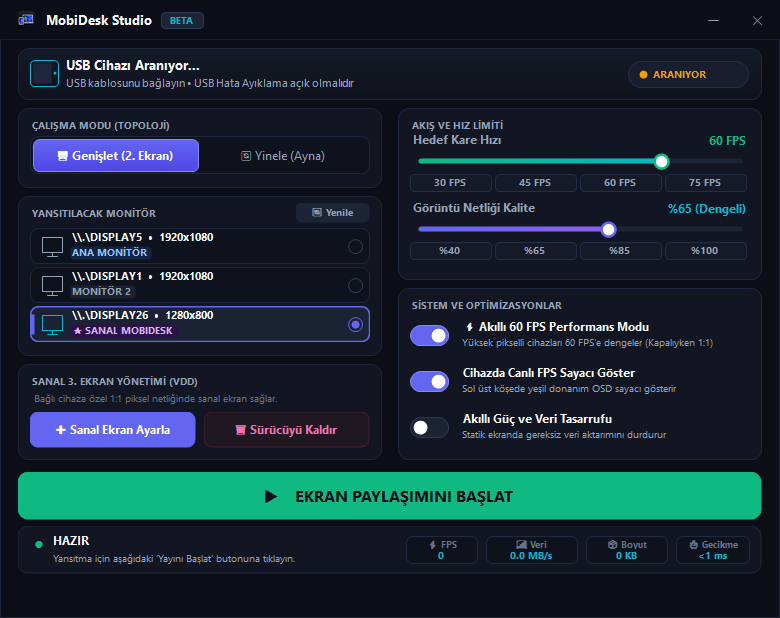

# 🖥️ MobiDesk - High-Performance Mobile Display & Monitor System

Turn your Android tablet or smartphone into a **60 FPS**, **ultra-low latency (<1 ms)**, and **touch-enabled** external monitor for Windows over a simple USB cable. 

MobiDesk provides a high-performance screen mirroring and virtual display extension solution optimized for seamless desktop workflows, secondary workspace expansion, and creative multitasking.

<div align="center">
  
</div>

---

## ⚡ Key Features

* **🚀 True 60 FPS & Smooth Playback:** Hardware-accelerated GDI capture combined with a multi-threaded Jitter-Buffer Resequencer architecture ensures fluid playback with 0% frame drops, even on low-end legacy tablets (e.g., Intel Baytrail Atom, Android KitKat/Lollipop) as well as modern Android devices.
* **🖥️ Virtual Display Driver (VDD) Integration:** Ships with an integrated virtual display driver that exposes a genuine, independent external display to Windows. Supports Windows display scaling (100%, 125%, 150%) at native tablet resolutions (e.g., 1280x800, 1920x1080).
* **👆 Bidirectional Touch Support:** Touch events on your tablet are instantly forwarded over TCP back to the PC, acting as native mouse clicks, touches, and drag-and-drop gestures.
* **📱 Automatic Device & DPI Detection:** Automatically queries ADB for device model name, resolution, and DPI to dynamically tune stream parameters.
* **🎨 Modern Dark Studio Dashboard:** Built with a custom dark UI featuring real-time telemetry (FPS counter, bandwidth in MB/s, frame size in KB, and transmission latency).
* **🔌 Zero-Config ADB Automation:** Automated reverse port tunneling (`tcp:55555`) and client app auto-launch handled automatically by the PC studio.

---

## 📖 MobiDesk Studio Interface Guide

The MobiDesk Studio interface consolidates all display, performance, and driver settings into a single, intuitive control panel:

### 1. Connected Device Info Card (Top Banner)
* Dynamically detects connected USB devices, displays native resolution (e.g., `1280x800`), screen DPI, and connection status.
* **CHANGE DEVICE Button:** If multiple devices are plugged in (e.g., a tablet and a phone), easily switch between them with a single click.

### 2. Operating Mode (Topology)
* **Extend (2nd Screen):** Turns your device into an independent secondary or tertiary monitor. Drag and drop windows freely from your main screen to your tablet.
* **Duplicate (Mirror):** Mirrors your PC's primary display 1:1 onto your mobile device (ideal for presentations, demonstrations, or stylus drawing).

### 3. Target Display Selector
* Lists all physical and virtual displays attached to your system (`PRIMARY MONITOR`, `MONITOR 2`, `★ VIRTUAL MOBIDESK`).
* Simply select **`★ VIRTUAL MOBIDESK`** to broadcast the virtual secondary workspace directly to your mobile screen.

### 4. Virtual Display Management (VDD)
* **`+ Configure Virtual Display`:** Installs and enables a virtual external display driver matched to your device's native resolution.
* **`🗑️ Uninstall Driver`:** Safely removes the virtual display driver and restores default system state whenever needed.

### 5. Stream Limits & Image Quality
* **Target Frame Rate (FPS):** Toggle between `30 FPS`, `45 FPS`, `60 FPS`, or `75 FPS` (Recommended: **60 FPS**).
* **Image Clarity (Quality):** Fine-tune JPEG compression between `40%` and `100%` (Recommended: **65% Balanced** or **85% High**).

### 6. System & Optimization Toggles
* **Smart 60 FPS Performance Mode:** Dynamically balances the pixel pipeline on high-resolution displays to guarantee a stable 60 FPS refresh rate.
* **Show Live FPS Counter on Device:** Displays a green on-screen display (OSD) telemetry counter on the mobile device (can also be toggled by double-tapping the tablet screen).
* **Smart Power & Bandwidth Saver:** Halts frame transmission when the screen is static, dramatically reducing PC CPU utilization and tablet battery consumption.

### 7. One-Click Streaming & Telemetry Status Bar
* **▶ START SCREEN STREAMING:** Launches the stream, starts the Android client automatically, and broadcasts at 60 FPS.
* **Live Telemetry Bar:** Displays real-time FPS, bandwidth utilization (**MB/s**), packet frame size (**KB**), and network latency (**<1 ms**).

---

## 🚀 Quick Start Guide

### Step 1: Prepare Your Android Device
1. Open **Settings > About Tablet/Phone** and tap **Build Number** 7 times to enable Developer Options.
2. Under **Developer Options**, turn on **USB Debugging**.
3. Connect your device to your PC via USB and check *"Always allow from this computer"* when prompted.
4. Install the Android client app:
   ```bash
   .\gradlew.bat assembleDebug
   adb install -r app\build\outputs\apk\debug\app-debug.apk
   ```

### Step 2: Launch the PC Application
1. Run **`MobiDesk.exe`**.
2. Once your device is detected, the status badge will indicate **READY**.
3. Click **Start Screen Streaming** — your desktop will instantly appear on your device!

### Step 3: Create a Virtual Second Monitor (Optional)
* To use your device as an independent desktop space, click **Configure Virtual Display** (or run `Sanal_Ekran_Ekle.bat` with administrator privileges).
* Right-click on your Windows desktop > **Display Settings**, and configure the new display to **"Extend desktop to this display"**.

---

## 📂 Project Structure

```
ScreenMonitoring/
├── app/                      # Android client application (Kotlin + SurfaceView Hardware Pipeline)
├── vdd/                      # Virtual Display Driver (Indirect Display Driver - IDD)
├── usbmmidd/                 # Device installer and helper utilities
├── ScreenMonitorGUI.cs       # PC Studio GUI and Streaming Server source code (C# / .NET 4.0)
├── MobiDesk.exe              # Standalone compiled PC executable
├── Sanal_Ekran_Ekle.bat      # Windows Virtual Monitor installer script
├── Sanal_Ekran_Kaldir.bat    # Windows Virtual Monitor uninstaller script
├── mobidesk_studio.png       # Studio dashboard screenshot
├── app_icon.ico / .png       # Application logos and icons
└── README.md                 # Project documentation
```

---

## 🛠️ Building from Source

### PC Application (C# / .NET 4.0)
The PC Studio application requires zero external third-party dependencies or package managers. It compiles natively using the built-in Windows .NET Framework 4.0 C# compiler:

```powershell
C:\Windows\Microsoft.NET\Framework64\v4.0.30319\csc.exe /nologo /target:winexe /unsafe /win32icon:app_icon.ico /win32manifest:app.manifest /out:MobiDesk.exe ScreenMonitorGUI.cs
```

### Android Client (Kotlin / Gradle)
```bash
.\gradlew.bat assembleDebug
```

---

## 📊 Performance Benchmarks

| Metric | Measured Value |
| :--- | :--- |
| **Target Frame Rate** | 60 FPS constant |
| **PC Screen Capture Latency** | ~9.0 ms (Hardware GDI COLORONCOLOR) |
| **JPEG Encoding Time** | ~2.8 ms |
| **Network Payload Size** | ~60 KB / frame (3.5 - 4.0 MB/s bandwidth) |
| **Tablet Decoding Time** | ~26 ms (Baytrail Atom Z3735G 4-Core) |
| **Display Rendering (Blit)** | ~1.0 ms (SurfaceView Hardware Canvas) |
| **Frame Loss / Jitter** | 0% (Jitter Buffer Resequencer) |

---

## 📜 License & Acknowledgments
This project is open-source. Virtual display capabilities are powered by the open-source *Virtual Display Driver (IddSampleDriver / MTT)* and *usbmmidd* components.
