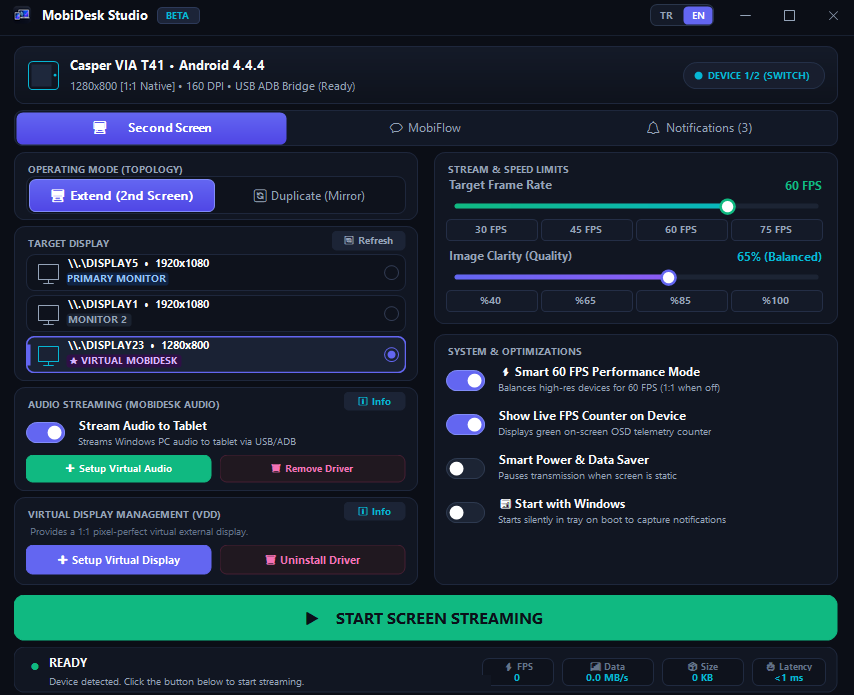
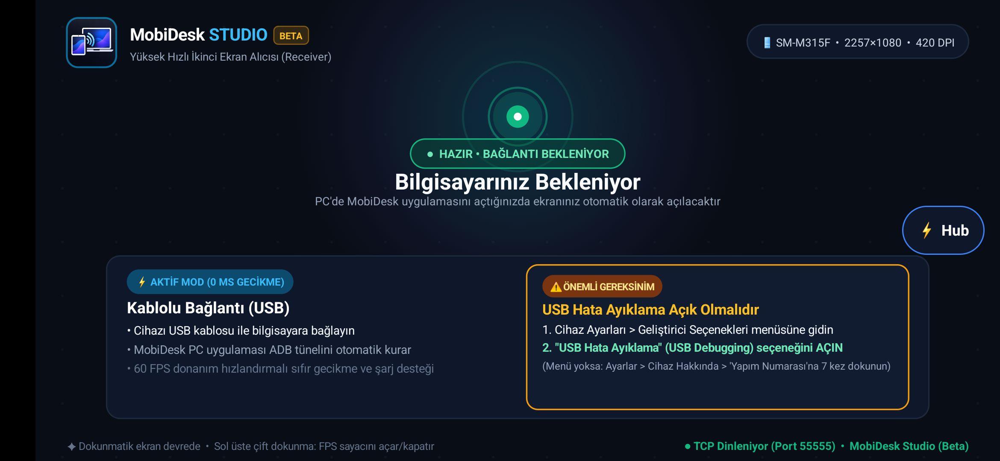

# 🖥️ MobiDesk - High-Performance Display & Mobile Continuity Ecosystem

[](https://github.com)
[](https://github.com)
[](https://github.com)
[](https://github.com)
[](https://github.com)

Turn your Android tablet or smartphone into a **true 60 FPS**, **ultra-low latency (<1 ms)**, and **touch-enabled** external monitor for Windows over a simple USB cable. 

**MobiDesk** also bridges your PC and mobile devices with **real-time PC audio streaming to your tablet/phone**, seamless **MobiFlow (instant file transfer & chat)**, real-time **MobiNotifications (notification mirroring with remote dismissal)**, and an on-screen floating **MobiHub drawer**.

---

<div align="center">
  <table>
    <tr>
      <td width="48%" align="center" valign="middle">
        
        <br/>
        <strong>🖥️ Windows PC Studio (Control Center)</strong>
      </td>
      <td width="52%" align="center" valign="middle">
        
        <br/>
        <strong>📱 Android Client (Standby & MobiHub)</strong>
      </td>
    </tr>
  </table>
  <p><em>MobiDesk Ecosystem - Zero-latency Windows desktop streaming paired with the on-screen Android receiver</em></p>
</div>

---

### 🌐 Quick Navigation
- [💡 How It Works](#-how-it-works)
- [🚀 Quick Start in 3 Steps](#-quick-start-in-3-steps)
- [⚡ Key Features](#-key-features)
- [💡 Real-World Use Cases](#-real-world-use-cases)
- [📊 Benchmarks & Technical Specs](#-benchmarks--specs)
- [🛠️ Build & Installation](#-build--installation)

---

## 💡 How It Works

MobiDesk is designed around simplicity, raw speed, and total privacy:

1. **🔌 100% Offline Local USB Connection:** No Wi-Fi congestion, no router setup, no cloud servers, and zero internet required. All data travels directly through the USB cable via automated ADB reverse tunneling.
2. **🚀 Hardware Display Pipeline:** Windows screen pixels are captured at hardware speed, compressed with minimal overhead, and sent directly to Android, where they are rendered at **stable 60 FPS** via a hardware-accelerated `SurfaceView`.
3. **🔊 Real-time Virtual Audio Streaming:** Windows system sound is captured directly through the virtual audio driver (VB-Cable/VDA) and streamed at 48 kHz stereo to your Android device speakers or headphones with imperceptible latency.
4. **👆 Interactive Touch Pass-Through:** Tapping or dragging on the mobile screen instantly maps back to Windows mouse clicks and gestures with sub-millisecond response time.
5. **💬 Seamless Continuity (MobiFlow & Notifications):** Drag and drop any file onto the PC app to send it to mobile, and manage phone notifications directly from your desktop.

---

## 🚀 Quick Start in 3 Steps

### 1️⃣ Prepare Device (30 Seconds)
1. Go to **Settings > About Tablet/Phone** and tap **Build Number** 7 times to enable Developer Options.
2. Under **Developer Options**, turn on **USB Debugging**.
3. Connect your device to your PC via USB and check **"Always allow from this computer"** when prompted.

### 2️⃣ Install & Launch
* **Android:** Install the APK (`adb install -r android/app/build/outputs/apk/debug/app-debug.apk`) and open the app.
* **PC:** Run **`Setup.bat`** for full Windows integration (Desktop & Start Menu shortcuts, Programs & Features registration) or run **`MobiDesk.bat`** (portable, zero-install).
* When connected, the status badge turns green: **READY**.

### 3️⃣ Start Streaming!
* Click **▶ START SCREEN STREAMING** — your Windows desktop appears on your mobile screen immediately!
* *(Optional - 2nd Screen & Audio):* Toggle **Stream Audio to Tablet** and click **Setup Virtual Display** to enjoy an independent secondary display with full audio!

---

## ⚡ Key Features

* **🖥️ 60 FPS & 0% Frame Drop:** Multi-threaded Jitter-Buffer architecture ensures silky-smooth playback even on older low-end tablets (e.g. Intel Atom Baytrail, Android 4.4 - 15).
* **🪟 Windows Virtual Display Driver (VDD):** Native secondary workspace extension at native device resolutions (1280x800, 1080p, 2K).
* **🔊 Real-time Virtual Audio Streaming (MobiDesk Audio):** Ultra-low latency stereo audio routing directly from Windows to your mobile device speakers or headphones.
* **💬 MobiFlow (AirDrop / Opera Flow Alternative):** Fast peer-to-peer file transfer and instant chat. Drop files on PC to receive on Android, or send photos/files from Android via native picker.
* **🔔 MobiNotifications:** Real-time phone notification cards on PC with **Dismiss** sync (dismissing on PC clears it from your phone).
* **🎛️ MobiHub Overlay Drawer:** A subtle floating handle on your mobile screen. Slide it out to chat or check notifications without stopping your secondary monitor.
* **🔌 Multi-Device Concurrent Support:** Connect your tablet (as a 2nd screen) and your smartphone (for notifications & files) at the same time.
* **🎨 Modern Slate Dark UI:** Custom dark cyberpunk theme with warm amber BETA badge, real-time FPS/latency telemetry, and instant **TR / EN** language switch.

---

## 💡 Real-World Use Cases

* **💻 Dedicated Second Workspace:** Place your tablet next to your keyboard and drag your IDE, Spotify, terminal, stock charts, or reference notes onto it.
* **🎧 Audio-Visual Entertainment Station:** Stream movies, podcasts, or music with synchronized video and audio directly on your bedside tablet.
* **📁 Instant Drag & Drop File Transfers:** Drop photos, documents, or APKs into the MobiDesk PC window to instantly receive them in your mobile Downloads folder.
* **🔔 Focus & Distraction-Free Workflow:** Receive phone notifications (WhatsApp, SMS, calls) directly on your PC screen and dismiss them without reaching for your phone.
* **🎛️ On-Device MobiHub Drawer:** Swipe open the **⚡ Hub** handle while streaming to send messages or pick files without closing or interrupting your active 2nd screen session.

---

## 📊 Benchmarks & Specs

| Feature | Value | How It Works |
| :--- | :--- | :--- |
| **Frame Rate** | **60 FPS constant** | Multi-threaded frame dispatcher & hardware blit |
| **Video Latency** | **< 1.0 ms** | Direct USB socket tunnel (`Port 55555`) |
| **Audio Latency** | **< 5.0 ms** | 48 kHz stereo virtual audio pipeline (`Port 55558`) |
| **CPU Overhead** | **< 3%** | Smart power saver pauses capture when screen is static |
| **MobiFlow Transfer** | **25 - 40 MB/s** | Dedicated non-blocking binary stream (`Port 55556`) |
| **Notification Sync** | **< 15 ms** | Real-time event socket (`Port 55557`) |

---

## 🛠️ Build & Installation

### Windows Native Setup (Recommended)
Install MobiDesk with full Windows system integration (Desktop shortcut, Start Menu shortcut, and Windows Add/Remove Programs entry):
```cmd
Setup.bat
```
To uninstall cleanly at any time, run:
```cmd
Kaldir.bat
```

### Standalone Portable Mode (Zero Dependencies)
You can also run or build MobiDesk portably without installation:
* **Launch directly:** Run `MobiDesk.bat` (or `MobiDesk.bat --test` for the 155-point automated test suite).
* **Compile standalone binary:**
  ```cmd
  desktop\build.bat
  ```
  *(Or compile manually via Microsoft .NET 4.0 `csc.exe` using `desktop\build.bat` instructions).*

### Virtual Display & Audio Drivers Setup
Automated lifecycle scripts are located under the `drivers/` directory:
* **Virtual Display Driver (Secondary Screen Extension)**:
  * Install: Run `drivers\display\Sanal_Ekran_Ekle.bat` (Run as Administrator)
  * Remove: Run `drivers\display\Sanal_Ekran_Kaldir.bat` (Run as Administrator)
* **Virtual Audio Driver (Real-time Audio Streaming)**:
  * Install: Run `drivers\audio\Sanal_Ses_Ekle.bat` (Run as Administrator)
  * Remove: Run `drivers\audio\Sanal_Ses_Kaldir.bat` (Run as Administrator)
*(Note: Virtual display and audio drivers can also be installed and toggled directly within the MobiDesk PC Studio UI).*

### Android Client (Gradle)
Build the Android debug APK from the repository root (delegates directly to `android/`):
```bash
.\gradlew.bat assembleDebug
```
Or navigate into `android/` and run `./gradlew assembleDebug`. The generated APK will be at `android\app\build\outputs\apk\debug\app-debug.apk`.

---

## 📜 License & Acknowledgments
Open-source project built for high-performance multitasking and seamless desktop continuity. Virtual display functionality powered by *Virtual Display Driver (IddSampleDriver / MTT)* and *usbmmidd*.
